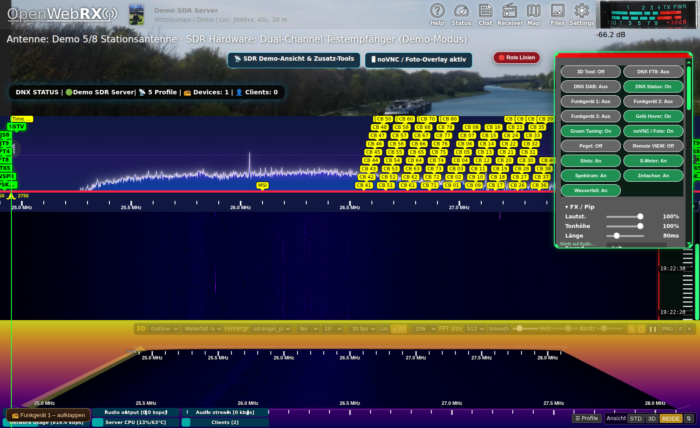
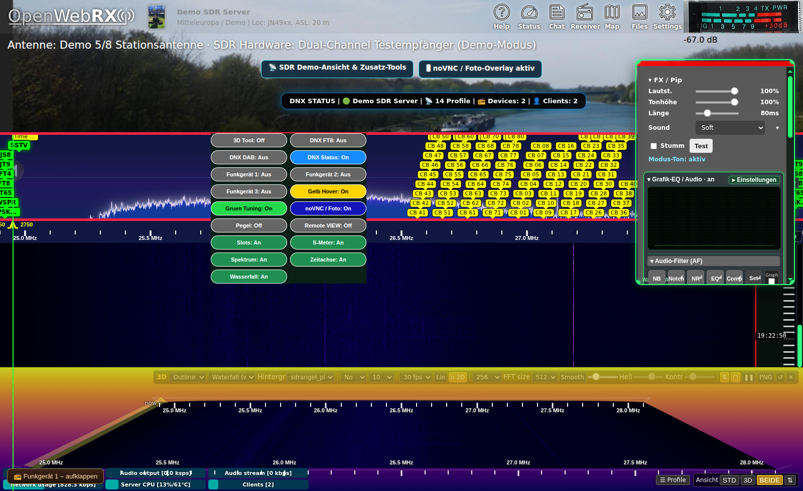

# DNX Receiver Tool Button Bar (`v1.1.0`)

<!-- DNX-DISCLAIMER-START -->
> **Wichtiger Hinweis / Vollständige Distanzierung (Hobby-Mod-Mode)**
>
> - **Vollständige Distanzierung:** Ich distanziere mich in jeder Hinsicht vollständig vom Projekt **OpenWebRX / OpenWebRX+** sowie dessen Entwicklern und Betreibern. Es besteht keinerlei Verbindung, Zusammenarbeit, Prüfung, Befürwortung oder Partnerschaft.
> - **Keine öffentlichen/offiziellen OpenWebRX-Plugins (nur Mod-Mode):** Bei diesem Projekt handelt es sich ausdrücklich **nicht** um ein öffentliches oder offizielles Plugin von OpenWebRX, sondern ausschließlich um einen privaten, inoffiziellen **Mod-Mode** (Eigenmodifikation).
> - **Warum bewusst kein reines Browser-JavaScript (Mod-Mode-Architektur):** Viele Funktionen (z. B. serverseitige Speicherung, Konten-/Rollenverwaltung, Profil-Synchronisation, VNC-/websockify-Brücken, geschützte Schnittstellen, Docker-/Systemintegration und stabile UI-Anpassungen) lassen sich sauber und sicher nicht allein über simples Client-JavaScript umsetzen, ohne den OpenWebRX-Kern umzubauen oder Browsergrenzen zu umgehen. Deshalb setzt dieses Projekt bewusst auf getrennte Begleitmodule, Shell-Installer und Dienste im **Mod-Mode** statt alles künstlich in reines JavaScript zu pressen.
> - **Kein öffentlicher Support & keine Haftung:** Es gibt **keinen öffentlichen Support**, keine Garantie und keine Haftung. Nutzung, Installation und Anpassung erfolgen vollständig auf eigene Gefahr (immer vorher Backups anlegen und zunächst im eigenen Testsystem prüfen).
> - **Reines Hobbyprojekt – frei nutzbar, änderbar & verbreitbar:** Dieses Projekt entsteht ausschließlich aus reinem Hobby und Interesse am gemeinsamen Funk-/SDR-Hobby. Es steht ausdrücklich frei zur Verfügung und darf frei genutzt, weiterverbreitet, verändert und verbessert werden.
<!-- DNX-DISCLAIMER-END -->

> **Important Notice / Full Disassociation (Hobby Mod-Mode Only)**
>
> - **Full Disassociation:** I completely disassociate myself from **OpenWebRX / OpenWebRX+** and its developers/maintainers. There is no affiliation, endorsement, review, or partnership of any kind.
> - **No Official/Public OpenWebRX Plugins (Mod-Mode Only):** These files are **not** official or public OpenWebRX plugins, but purely unofficial hobby modifications (*mod-mode*).
> - **Why Not Everything in Pure Browser JavaScript:** Many features (server-side persistence, account/role management, profile syncing, VNC/websockify bridges, protected endpoints, and Docker/host integration) cannot be implemented cleanly or reliably in client-side JavaScript alone without modifying the OpenWebRX core or hitting browser/security limits. That is why this project intentionally uses separate companion scripts, services, and *mod-mode* hooks rather than forcing everything into pure JS.
> - **No Public Support & No Warranty:** There is **no public support**, no warranty, and no liability. Use entirely at your own risk (always create backups and verify on a test system first).
> - **Pure Hobby Project — Free to Use, Modify & Redistribute:** Created solely out of personal hobby interest in the radio/SDR hobby; freely available to use, share, modify, and improve.

<!-- DNX-PREVIEW-START -->
## Live-Vorschau & Galerie / Live Preview (`DNX Receiver Tool Button Bar`)



| Ansicht / View | Beschreibung / Description | Screenshot |
|---|---|---|
| **Eingedockte 15-Button-Werkzeugzeile** | Kompaktes 2-Spalten-Raster aller 15 DNX-Schalter (`Gelb Hover`, `Gruen Tuning`, `DNX Status`, `3D Tool`, `noVNC / Foto`, `Remote VIEW`, `Besucherliste`, `FT8`, `CB Funk`, `HF Funk`, `AIS`, `ADSB`, `Wetter`, `3D Karte`, `Styler`) sauber oben im Receiver-Panel |  |
| **Abgezogene Leiste & umsortierte Buttons** | Komplette Werkzeugzeile über den Griff (`⠿ Werkzeuge`) schwebend auf die Oberfläche gezogen und Buttons (`DNX Status`, `Gelb Hover`, `noVNC / Foto`, …) per Drag & Drop neu geordnet |  |
<!-- DNX-PREVIEW-END -->

Stabile gemeinsame Receiver-Schalterzeile (`v1.1.0`) für bis zu **15 DNX-Module** – wahlweise fest oben im Receiver-Panel oder als frei schwebende Werkzeugleiste.

Unified 15-tool Receiver Button Bar (`v1.1.0`) with fixed color-coded state indicators, floating drag-handle (`⠿ Werkzeuge`), per-button drag-and-drop reordering, and double-click layout reset.

## Neu in v1.1.0 / What's New

- **Komplette Werkzeugleiste abziehbar (`dnx.toolrow.pos.v1`):** Über die obere Griffleiste (`⠿ Werkzeuge`) lässt sich die komplette Box auf jede Position der Oberfläche ziehen und dort fixieren.
- **Buttons per Drag & Drop sortieren (`dnx.toolrow.order.v1`):** Jeder einzelne Werkzeug-Button lässt sich über benachbarte Buttons ziehen, um die persönliche Reihenfolge dauerhaft festzulegen.
- **Doppelklick = Reset:** Doppelklick auf den Griff stellt die Standard-Reihenfolge her und dockt die Leiste wieder im Receiver-Panel an.
- **Alle 15 DNX-Werkzeuge abgedeckt:** `Gelb Hover`, `Gruen Tuning`, `DNX Status`, `3D Tool`, `noVNC / Foto`, `Remote VIEW`, `Besucherliste`, `FT8`, `CB Funk`, `HF Funk`, `AIS`, `ADSB`, `Wetter`, `3D Karte`, `Styler`.
- **Keine Animationen / kein Zappeln:** Ruhiges CSS-Grid ohne Flackern; echte Live-Zustandsabfrage alle `500 ms`.

## Installation

```bash
chmod +x install.sh
sudo ./install.sh install
# Nativ / ohne Docker:
sudo TYP=normal PLUGINS=/usr/lib/python3/dist-packages/htdocs/plugins ./install.sh install
./install.sh status
sudo ./install.sh update
sudo ./install.sh uninstall
```

Backups: `/opt/dnx-tool-button-bar-backups`.

---

## Verbindungen im DNX-Ökosystem


* **Verbindung zu `DNX-Styler` (`#dnx-master-tool-row` & `TOOL_DEFS`):** Im Voll-Styler werden bis zu `26` Werkzeuge (`TOOL_DEFS`) in derselben Receiver-Schalterzeile gebündelt; dieses Standalone-Paket liefert die abziehbare (`dnx.toolrow.pos.v1`) und per Drag & Drop sortierbare (`dnx.toolrow.order.v1`) 15-Button-Werkzeugzeile ohne Voll-Styler.
* **Verbindung zu `DNX-Receiver-Account-Control`:** Jeder angebundene Modul-Button respektiert die vom Konto-Server (`:8095/api/me`) gelieferten Werkzeugrechte (`window.DNXReceiverRights`).
